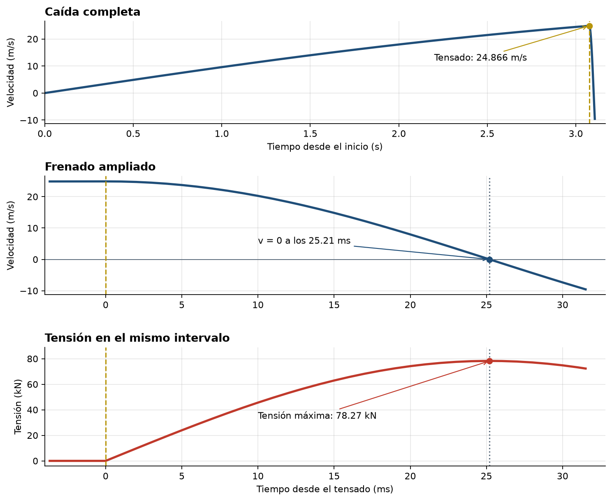
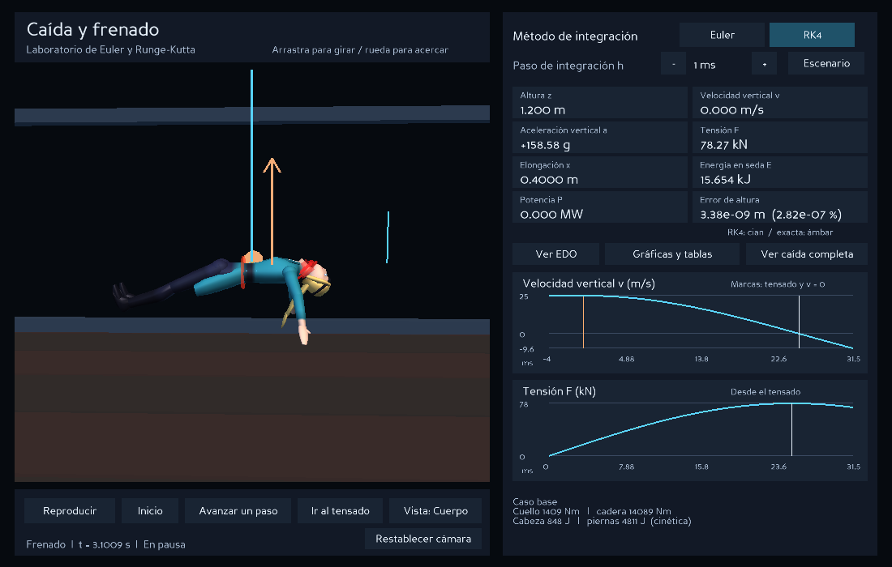
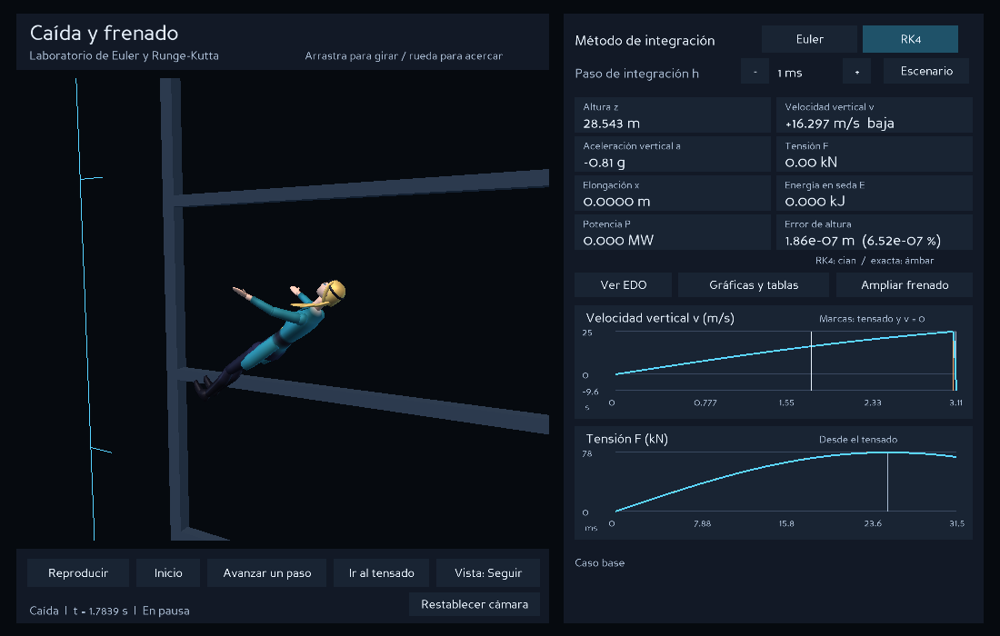
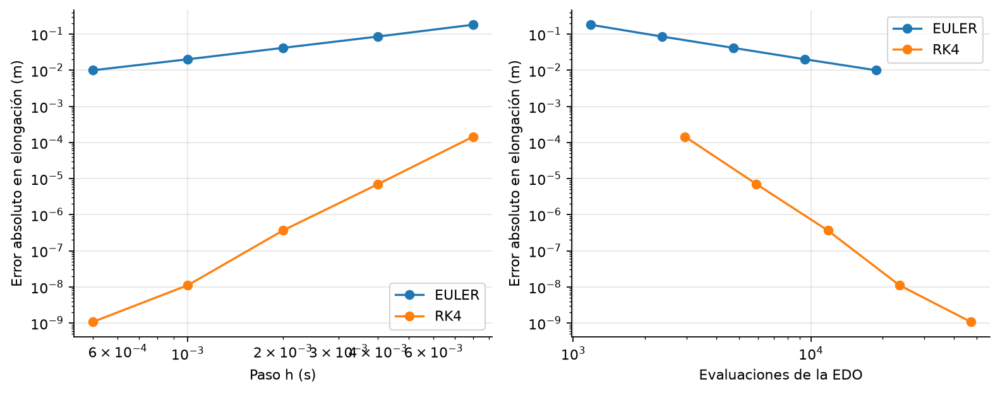
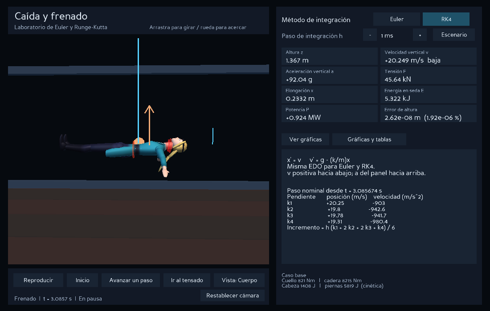
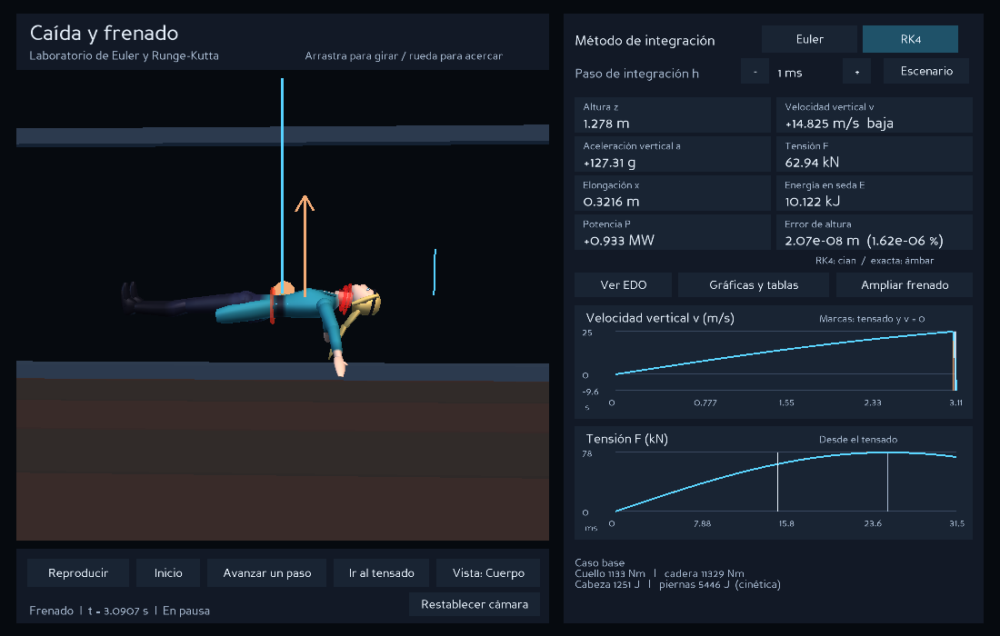
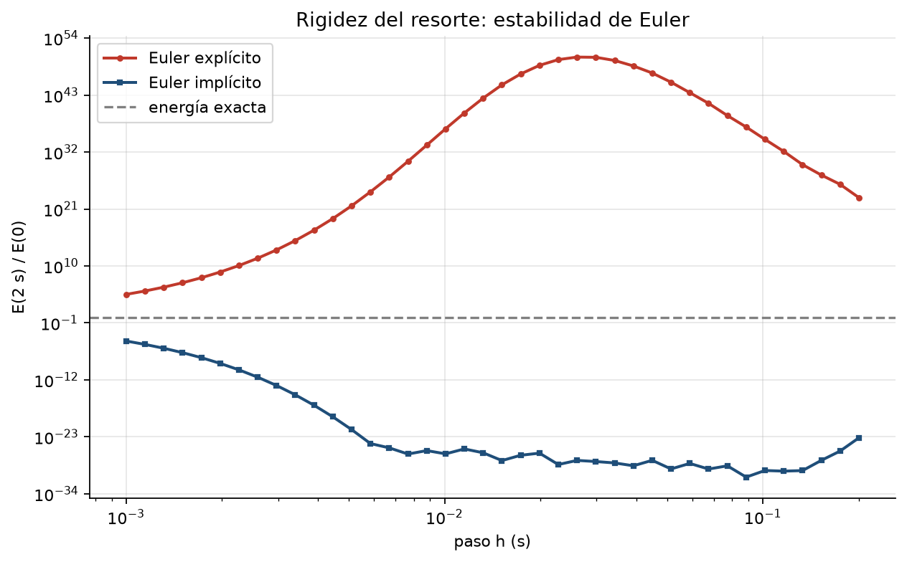
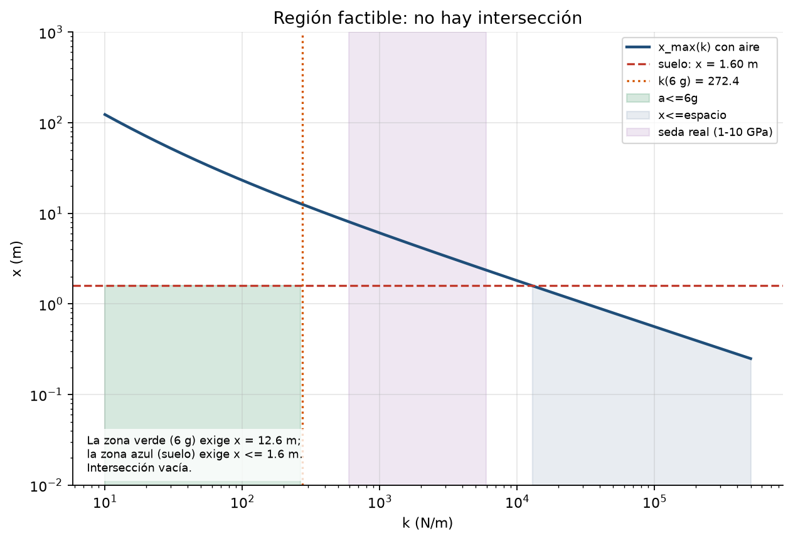
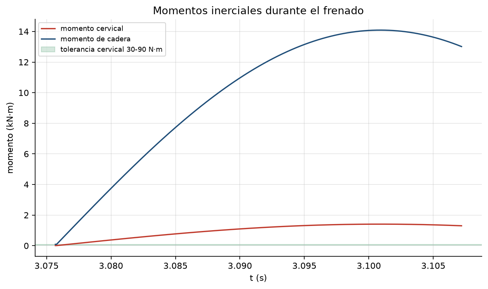
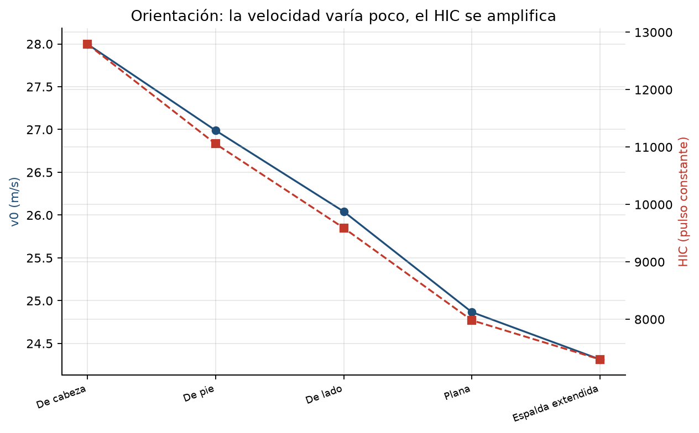

# La caída de Gwen Stacy · Laboratorio de Euler y Runge–Kutta

**Curso** · Métodos Numéricos

**Autor** · Diego

El proyecto resuelve la caída con arrastre y el frenado por la seda con **Euler
explícito y Runge–Kutta clásico de cuarto orden (RK4)**. El visor de escritorio
en Panda3D muestra la trayectoria, las fuerzas y la energía mientras compara
cada corrida con la solución analítica. La torre y la postura de espaldas se
inspiran en la escena de la película. Las dimensiones y los parámetros físicos
se tratan como estimaciones.

## Abrir el simulador

En Linux, busca **Gwen Stacy - Simulador 3D** en el catálogo de aplicaciones.
Si estás preparando el proyecto en otra cuenta, [instala las dependencias](#7-ejecución-y-estructura)
y registra la entrada. El instalador usa el Python del entorno virtual y abre
el visor desde el directorio del proyecto.

```bash
.venv/bin/python scripts/instalar_lanzador.py
.venv/bin/python -m visual.app_panda3d
```

## Velocidad y tensión durante la caída



En el caso base, el torso parte del reposo y alcanza **24.866 m/s** al
tensarse la seda, unos **3.07567 s** después de iniciar la caída. El pulso de
frenado ocupa apenas el **0.8 %** de ese tiempo. La ampliación permite ver qué
ocurre dentro de ese intervalo. La línea dorada marca el tensado y la gris
punteada marca el primer cero de velocidad.

| Instante | Tiempo desde el tensado | Qué cambia |
|---|---:|---|
| Tensado | 0 ms | El torso baja a **24.866 m/s**. La elongación y la tensión empiezan en cero. |
| Potencia pico | ≈12.62 ms | El producto de tensión y velocidad alcanza **0.976 MW**. |
| Primera detención | **25.21 ms** | La velocidad llega a **0 m/s**. La seda alcanza **0.400 m**, **78.27 kN** y **15.654 kJ** almacenados. |
| Retorno elástico | Después de 25.21 ms | La velocidad cambia de signo y el torso empieza a subir en el modelo de resorte. |

Durante el frenado, el torso todavía baja mientras disminuye su velocidad.
La seda sigue estirándose y su tensión aumenta. Al llegar a `v = 0`,
la tensión es máxima y la potencia instantánea `P = Fv` vuelve a cero.
Para explorar valores por instante, consulta el [CSV de la corrida RK4 con h = 1 ms](resultados/e11_perfiles.csv).



*Captura del visor en la primera detención. La gráfica de arriba ya está
ampliada alrededor del tensado. La lectura de velocidad muestra
**0.000 m/s** y la tensión está en su máximo.*

## Cómo usar el laboratorio

| Control | Acción |
|---|---|
| **Reproducir / Pausar** | Controla el reloj de reproducción. La cámara lenta comienza al tensarse la seda y reproduce el frenado al 5 %. |
| **Inicio** | Vuelve al instante inicial y deja la corrida en pausa. |
| **Avanzar un paso** | Salta a la siguiente muestra de la malla de integración o a una frontera entre fases. |
| **Ir al tensado** | Pausa en el agarre abdominal y cambia a la vista lateral **Cuerpo**. |
| **Euler / RK4** | Cambia el método que resuelve la misma EDO en cada fase. El botón activo se resalta. |
| **Paso de integración `h`** | Cambia el tamaño de paso entre **0.25, 0.5, 1, 2, 4 y 8 ms**. |
| **Escenario** | Selecciona el caso base o uno de los dos ejemplos de contacto con el piso. |
| **Vista** | Alterna entre **Seguir**, **Cuerpo** y **Torre**. |
| **Ampliar frenado** | Cambia la gráfica de velocidad de la caída completa, en segundos, al entorno del tensado, en milisegundos. |
| **Gráficas y tablas** | Abre una ventana amplia con la corrida activa, gráficas interactivas y la tabla de muestras. |
| **Ver EDO** | Muestra la ecuación activa y, en pausa, la pendiente del paso de Euler o las cuatro etapas de RK4. |
| **Restablecer cámara** | Recupera el encuadre de la vista activa. |

En pausa, **arrastra horizontalmente dentro del área 3D** para girar alrededor
del punto de mira. Usa **la rueda** para acercarte o alejarte. La escena y
las mediciones conservan el instante pausado. Al reanudar, la cámara recupera
su seguimiento. Con el teclado, **Espacio** reproduce o pausa, **Inicio** reinicia
y **→** avanza un paso. **Esc** cierra el visor.

El panel se mantiene a la derecha del render incluso cuando el gestor abre
la ventana en mosaico o la redimensiona. Las tarjetas muestran altura,
velocidad, aceleración, tensión, elongación, energía elástica, potencia y
error de altura. La gráfica cian corresponde al método activo y la ámbar
a la solución analítica. La línea blanca indica el instante visible.
La velocidad es positiva hacia abajo y su signo cambia cuando el torso sube.
La aceleración del panel se expresa en `g`, con signo positivo hacia arriba.

En **Gráficas y tablas**, la velocidad y la tensión comparten el eje de
tiempo desde el inicio. La tensión de la seda es cero durante la caída
previa al agarre. Gira la rueda sobre cualquiera de las curvas para ampliar
alrededor del puntero. Usa **Pan** en la barra para desplazar la vista, o
**Zoom** para seleccionar un rectángulo. **Caída completa** y **Frenado**
recuperan esos intervalos. La tercera gráfica permite elegir altura,
aceleración, elongación, potencia o energía. Un clic coloca el cursor
en las tres gráficas. En **Tablas**, **Mostrar intervalo visible** filtra
las muestras por el zoom actual y un doble clic lleva el cursor a esa fila.
La ventana conserva el método, el paso y el escenario con los que se abrió.



## Cómo se comparan Euler y Runge–Kutta

En caída se integra `(y', v') = (v, g − ρ Cd A v² / (2m))` desde el reposo.
Para un paso manual de `h = 0.01 s`, Euler da `y₁ = 0` y
`v₁ = 0.0981 m/s`. RK4 combina cuatro pendientes con pesos
`(1, 2, 2, 1)/6` y obtiene `y₁ ≈ 0.0004905 m` con
`v₁ ≈ 0.09810 m/s`. En `y = H` se localiza el cruce con un interpolante
de Hermite. Luego se inicia la fase elástica desde `(x, v) = (0, v_tensado)`
y se integra `(x', v') = (v, g − kx/m)` con el mismo `k` en ambas corridas.

| Método con `h = 4 ms` | Elongación máxima | Error absoluto | Error relativo | Evaluaciones de la EDO |
|---|---:|---:|---:|---:|
| Euler | 0.485570 m | 0.085570 m | 21.39 % | 2 364 |
| RK4 | 0.399993 m | 0.000007 m | 0.00175 % | 5 907 |
| Referencia analítica | 0.400000 m | — | — | — |

El [barrido de convergencia](resultados/e11_caida.csv) incluye tiempos,
velocidad de tensado, elongación, fuerza, potencia y energía con cinco pasos
entre 0.5 y 8 ms. El coste incluye las evaluaciones del integrador y las
pendientes usadas para interpolar. La comparación a paso igual muestra la
precisión por paso. La comparación a coste similar se lee en el eje de
evaluaciones. El error global acumula el truncamiento durante la integración.
Los cruces y picos también dependen de cómo se localizan entre pasos.





## Resolución paso a paso del caso base

### 1. Plantear la EDO de la caída

Se mide el desplazamiento $y$ hacia abajo desde el punto inicial.
La altura sobre el suelo es $z=43.60-y$. Al soltar el cuerpo,
$y(0)=0$ y $v(0)=0$. El peso apunta hacia abajo y el arrastre hacia
arriba durante la caída. La segunda ley de Newton da

$$
m\frac{dv}{dt}=mg-\frac12\rho C_d A v^2.
$$

Con $m=50\ \mathrm{kg}$, $\rho=1.20\ \mathrm{kg/m^3}$,
$C_d A=0.60\ \mathrm{m^2}$ y $g=9.81\ \mathrm{m/s^2}$, el
coeficiente del término cuadrático es $\rho C_d A/(2m)=0.0072\ \mathrm{m^{-1}}$.
Se introducen las dos componentes del estado $Y=(y,v)$:

$$
Y'=f(Y)=(v,\ 9.81-0.0072v^2).
$$

### 2. Dar el primer paso con Euler y RK4

Con $h=1\ \mathrm{ms}=0.001\ \mathrm{s}$, Euler evalúa una pendiente
$k_1=f(Y_0)=(0,9.81)$ y aplica $Y_1=Y_0+h k_1$. Así obtiene
$y_1=0$ y $v_1=0.009810\ \mathrm{m/s}$. El desplazamiento del primer
paso es cero porque Euler usa la velocidad al inicio del intervalo.

RK4 también arranca con $k_1=f(Y_0)$. Para calcular $k_2$, se estima
el estado de mitad de paso como $Y_0+(h/2)k_1=(0,0.004905)$. Al evaluar
la EDO allí se obtiene
$k_2=(0.004905,9.81-0.0072(0.004905)^2)$. El procedimiento se repite
con la pendiente nueva para $k_3$ y luego al final del paso para $k_4$.

| Etapa | Estado donde se evalúa | Pendiente de posición (m/s) | Pendiente de velocidad (m/s²) |
|---|---|---:|---:|
| $k_1$ | $Y_0$ | 0 | 9.81000000 |
| $k_2$ | $Y_0+(h/2)k_1$ | 0.00490500 | 9.80999983 |
| $k_3$ | $Y_0+(h/2)k_2$ | 0.00490500 | 9.80999983 |
| $k_4$ | $Y_0+h k_3$ | 0.00981000 | 9.80999931 |

Se combina $Y_1=Y_0+(h/6)(k_1+2k_2+2k_3+k_4)$. El resultado es
$y_1\approx 0.000004905\ \mathrm{m}$ y
$v_1\approx 0.009810\ \mathrm{m/s}$. Cada método vuelve a aplicar su
regla al estado obtenido y continúa hasta encontrar el cruce $y=42.00\ \mathrm{m}$.

### 3. Encontrar el tensado y calibrar la seda

Cuando dos muestras encierran el cruce, el programa construye un interpolante
de Hermite con los estados y sus pendientes. Busca dentro del intervalo la
raíz de $y(t)-42.00=0$ y evalúa allí la velocidad. Con pasos de 1 ms,
Euler obtiene $t=3.076085\ \mathrm{s}$ y $v=24.869960\ \mathrm{m/s}$.
RK4 obtiene $t=3.075674\ \mathrm{s}$ y $v=24.866137\ \mathrm{m/s}$.

Para verificar el resultado, se calcula primero la velocidad terminal
$v_t=\sqrt{g/0.0072}\approx36.91\ \mathrm{m/s}$. La solución cerrada
de la caída da
$t_f=(v_t/g)\operatorname{arcosh}[\exp(gH/v_t^2)]$ y
$v_0=v_t\tanh(g t_f/v_t)$. Con $H=42.00\ \mathrm{m}$ se recupera
$v_0=24.866137\ \mathrm{m/s}$.

Para calibrar la seda, se fija la elongación máxima en 0.40 m. El trabajo
de la gravedad durante ese tramo se suma a la energía cinética al tensarse:

$$
\tfrac12 k(0.40)^2
=\tfrac12(50)(24.866137)^2+(50)(9.81)(0.40)
=15\,654.32\ \mathrm{J}.
$$

Al despejar se obtiene $k=195\,679\ \mathrm{N/m}$. Este valor se usa en
ambas corridas. Cada una conserva su propia velocidad numérica de tensado,
de modo que la comparación también refleja el error que trae desde la caída.

### 4. Integrar el frenado hasta el primer cero de velocidad

Se reinicia el reloj local al tensarse la seda. El estado es ahora
$X=(x,v)$, donde $x$ es la elongación. Del peso $mg$ y la tensión
ascendente $kx$ resulta

$$
x'=v,\qquad v'=g-\frac{k}{m}x=9.81-3913.58x.
$$

Euler parte de $X_0=(0,24.869960)$. En ese instante la seda todavía tiene
elongación cero, así que la pendiente es $(24.869960,9.81)$. Con
$h=0.001\ \mathrm{s}$ obtiene $x_1=0.024870\ \mathrm{m}$ y
$v_1=24.879770\ \mathrm{m/s}$. La aceleración cambia de signo una vez
que la tensión supera el peso. Euler evalúa ese efecto a partir del paso
siguiente.

RK4 parte de $X_0=(0,24.866137)$. Su primera pendiente es
$(24.866137,9.81)$. A mitad del paso, la estimación
$x\approx0.012433\ \mathrm{m}$ ya produce una aceleración de
$9.81-3913.58(0.012433)\approx-38.85\ \mathrm{m/s^2}$. Por eso el
efecto del resorte entra en el primer paso de RK4.

| Etapa de RK4 | $x'$ (m/s) | $v'$ (m/s²) |
|---|---:|---:|
| $k_1$ | 24.866137 | 9.810000 |
| $k_2$ | 24.871042 | −38.847806 |
| $k_3$ | 24.846713 | −38.857404 |
| $k_4$ | 24.827280 | −87.429596 |

Con los mismos pesos de la primera fase se obtiene
$x_1=0.024855\ \mathrm{m}$ y $v_1=24.827299\ \mathrm{m/s}$.
Se siguen dando pasos hasta encerrar el primer cruce de $v=0$ y se
refina la raíz dentro del intervalo. Ese cruce marca la elongación máxima.
La solución analítica lo verifica con
$\omega=\sqrt{k/m}$ y $t_{\mathrm{pico}}=(\pi-\arctan(v_0\omega/g))/\omega$.

### 5. Obtener y comprobar las respuestas

| Resultado con $h=1$ ms | Euler | RK4 | Referencia analítica |
|---|---:|---:|---:|
| Tiempo desde el tensado hasta $v=0$ | 25.24258 ms | 25.21000 ms | 25.21000 ms |
| Elongación máxima | 0.420074 m | 0.400000 m | 0.400000 m |
| Tensión máxima | 82.200 kN | 78.272 kN | 78.272 kN |
| Aceleración pico hacia arriba | 166.583 g | 158.575 g | 158.575 g |
| Potencia pico de la seda | 1.02602 MW | 0.97571 MW | 0.97571 MW |
| Energía máxima en la seda | 17.265 kJ | 15.654 kJ | 15.654 kJ |

1. **Altura.** Se resta la caída y la elongación a la altura inicial.
   En la referencia, $43.60-42.00-0.40=1.20\ \mathrm{m}$.
2. **Fuerza y aceleración.** Se evalúa $F=kx$ y se resta el peso para
   hallar la aceleración neta hacia arriba. En el pico,
   $F=78\,271.60\ \mathrm{N}$ y
   $a/g=(F/50-9.81)/9.81=158.575$.
3. **Energía.** Se reemplaza $x_{\max}$ en $kx_{\max}^2/2$.
   Los **15.654 kJ** se componen de **15.458 kJ** cinéticos al tensarse
   y **0.196 kJ** de trabajo de la gravedad durante la elongación.
4. **Potencia.** Se calcula $P(t)=kx(t)v(t)$ a lo largo del frenado
   y se localiza el máximo cerca de los **12.62 ms**. En el tensado
   $x=0$ y en la primera detención $v=0$, así que en ambos instantes
   la potencia es cero.
5. **Momento cervical.** Con 5 kg de masa de cabeza, brazo de 0.18 m
   y $a_t=1555.62\ \mathrm{m/s^2}$ hacia arriba, el modelo estima
   $M=5(0.18)(1555.62+9.81)\approx1409\ \mathrm{N\,m}$.
6. **Error numérico.** Para la elongación de Euler se obtiene
   $|0.420074-0.400000|=0.020074\ \mathrm{m}$, equivalente al
   **5.02 %** de la referencia. El [barrido](resultados/e11_caida.csv)
   muestra cómo disminuye el error al reducir el paso.

Para repetir los cálculos sin aire se anula el coeficiente de arrastre en la EDO de caída:
la condición $y=42$ da $v_0=\sqrt{2g(42)}=28.7061\ \mathrm{m/s}$.
Si además se fija el objetivo de aceleración en 6 g, se despeja la rigidez
con $k=m((6g)^2-g^2)/v_0^2$. Con aire resulta $k=272.37\ \mathrm{N/m}$
y el balance de energía da 12.61 m de elongación. El espacio disponible
en el caso base es 1.60 m. El [anexo de resolución manual](#anexo-a--modelo-matemático-y-resolución-manual)
desarrolla estos escenarios y el cálculo del índice HIC equivalente.

## 1. Introducción y pregunta

¿Cuánta energía recibió el cuerpo de Gwen Stacy y por qué esa energía no pudo
liberarse de forma gradual?

En el caso base, el torso llega al tensado con **15.458 kJ** de energía
cinética. Durante los siguientes 0.40 m, la gravedad aporta otros
**0.196 kJ**. El resorte ideal almacena la suma, **15.654 kJ**, en unos
**25 ms**. El frenado en una distancia tan corta lleva la potencia pico
a unos **0.976 MW** y la aceleración pico a **158.58 g**. En el caso sin aire
calibrado para la misma elongación, la aceleración pico alcanza **211 g**.

El proyecto reproduce la escena con tres modelos:

1. caída con arrastre cuadrático,
2. telaraña elástica lineal,
3. cuerpo articulado anclado en el torso.

El caso de validación es el análisis de la Universidad de Leicester (2021),
que con una caída de 42 m sin aire y 50 kg obtiene `v ≈ 28.7 m/s`, `x ≈ 16.7 m`,
`k ≈ 204.5 N/m` y `E ≈ 343 MPa` para un límite de 6 g. El mecanismo del
latigazo es el que Marvel confirmó en el correo de lectores de *ASM* #125.



---

## 2. Modelo matemático

### 2.1 Geometría

La escena se fija con cuatro datos coherentes:

| Magnitud | Valor | Origen |
|---|---:|---|
| Altura del ancla | 43.60 m | repisa inferior de la torre |
| Longitud tensa de la seda | 42.00 m | dato de la escena |
| Estiramiento de calibración | 0.40 m | estimación de la escena |
| Altura final del torso | 1.20 m | `43.60 − 42.00 − 0.40` |
| Masa del cuerpo | 50 kg | supuesto de la simulación, consistente con Leicester |
| `Cd·A` base | 0.60 m² | caída de espaldas/plana |
| Densidad del aire | 1.20 kg/m³ | aire a ~20 °C |

La verificación geométrica es exacta:

```
43.60 − 42.00 − 0.40 = 1.20 m
```

El ancla no está en la cúspide de los 72 m: Spider-Man se ancla en una repisa
inferior. El caso de la torre completa, con 70.4 m de caída, queda como
escenario paramétrico.

**Espacio libre.** En el instante de tensado el torso está a
`43.60 − 42.00 = 1.60 m` del suelo. Cualquier estiramiento mayor que 1.60 m
hace que el torso toque el suelo antes de detenerse. Este dato es central para
la conclusión.

### 2.2 Fase 1: caída con arrastre cuadrático

```
m dv/dt = m g − ½ ρ Cd A v²,     v(0)=0,  y(0)=0
```

Con `c = ½ ρ Cd A` y `v_t = sqrt(m g / c)`:

```
v(t) = v_t tanh(g t / v_t)
y(t) = (v_t²/g) ln cosh(g t / v_t)
```

El tiempo de caída se obtiene de `y(t_f) = H`:

```
t_f = (v_t/g) arccosh(exp(g H / v_t²))
```

Para el escenario base: `t_f = 3.076 s`, `v_t = 36.91 m/s`,
`v_0 = 24.87 m/s`.

### 2.3 Fase 2: telaraña elástica

```
m ẍ = m g − k x,     x(0)=0,  ẋ(0)=v_0
ω = sqrt(k/m)
x(t) = (g/ω²)(1 − cos ωt) + (v_0/ω) sin ωt
```

La aceleración máxima y el primer instante con `ẋ = 0` son:

```
a_max = sqrt(g² + (k/m) v_0²)
t_pico = (π − atan(v_0 ω / g)) / ω
```

La energía absorbida por la seda es:

```
E = ½ m v_0² + m g x_max
```

y la rigidez en modo calibración:

```
k = m(v_0² + 2 g x_max) / x_max²
```

En modo material se fija `k` y se despeja `x_max` de la misma ecuación
energética. Los dos modos se etiquetan explícitamente en todos los experimentos.

### 2.4 Potencia

La potencia instantánea es `P(t) = k x(t) ẋ(t)`. **No** es `F_max·v_0`: la
fuerza máxima ocurre cuando `ẋ = 0` y la velocidad máxima cuando `x = 0`.
Para el escenario base, `P_pico = 0.976 MW`; para el caso sin aire, `1.495 MW`.
La cota `F_max·v_0` (2.985 MW sin aire) se reporta solo como cota superior.

### 2.5 Fase 3: cuerpo articulado anclado en el torso

El cuerpo es atrapado en el torso. La cabeza (5 kg) y las piernas (20 kg) son
segmentos unidos por el cuello (0.18 m) y la cadera (0.45 m). La carga
cuasiestática en el pico es:

```
M_cuello = m_cabeza · r_cuello · (a_t + g)
M_cadera = m_piernas · r_cadera · (a_t + g)
```

Con `a_t = 158.6 g`: `M_cuello ≈ 1.41 kN·m` y `M_cadera ≈ 14.1 kN·m`.
Con `a_t = 6 g`: `M_cuello ≈ 61.8 N·m`, dentro del rango orientativo de
tolerancia cervical (30–90 N·m) pero en su límite alto.

El torso se detiene a 1.20 m y **no** se afirma que la cabeza o las piernas
golpeen el suelo: con el anclaje en el torso y esas longitudes, es
geométricamente imposible. El latigazo se mide por el momento cervical y la
aceleración relativa, no por un impacto contra el piso.

### 2.6 Criterio HIC

```
HIC = max (t₂ − t₁) · [ (1/(t₂−t₁)) ∫ a dt ]^2.5,   t₂ − t₁ ≤ 36 ms
```

La aceleración se expresa en g. El HIC es un criterio de **cabeza**; en este
proyecto se usa como índice comparativo de la carga del torso/cabeza y se
etiqueta como tal. Con un pulso constante de 158.6 g durante 25.2 ms el HIC es
`≈8·10³`; con la forma real del pulso (triangular) baja a `≈5·10³`. El
escenario de 6 g durante 0.86 s da `HIC ≈ 3.2` en la ventana de 36 ms (el valor
de ~70 que a veces se cita usa una ventana de 0.8 s, incompatible con la
definición).

---

## 3. Solución analítica y métodos numéricos

### 3.1 Caso base con aire

| Magnitud | Valor |
|---|---:|
| `v_0` | 24.866 m/s (89.5 km/h) |
| `k` | 195 679 N/m |
| `x_max` | 0.40 m |
| `a_max` | 158.58 g |
| `F_max` | 78.27 kN (160× el peso) |
| Energía almacenada por la seda | 15.654 kJ |
| `P_pico` real | 0.9757 MW |
| `t_pico` | 25.21 ms |
| `E` implícito de la seda | 328.74 GPa |
| `ε` | 0.95 % |
| `M_cuello` | 1.41 kN·m |
| `M_cadera` | 14.09 kN·m |
| HIC equivalente del torso | 5 115 |

### 3.2 Validación de Leicester (sin aire)

Hay dos corridas sin aire. La calibración a `x_max = 0.40 m` aísla el
efecto del arrastre respecto del caso base. La validación de Leicester
usa el mismo descenso de 42 m y fija una aceleración objetivo de 6 g.

| Magnitud para el frenado calibrado a 0.40 m | Valor sin aire |
|---|---:|
| Velocidad al tensarse | 28.706 m/s |
| Rigidez | 259 965 N/m |
| Aceleración pico | 211.0 g |
| Tensión máxima | 103.99 kN |
| Energía en la seda | 20.797 kJ |
| Potencia pico | 1.495 MW |
| Tiempo hasta el primer cero de velocidad | 21.85 ms |
| Módulo implícito de la seda | 436.74 GPa |

| Magnitud | Proyecto | Paper |
|---|---:|---:|
| `v_0` | 28.706 m/s | 28.7 |
| `x` | 16.80 m | 16.7 |
| `k` | 204.375 N/m | 204.5 |
| `E` | 343.35 MPa | ~343 |
| `ε` | 40.0 % | — |

La diferencia de `x` (16.80 vs 16.7) es redondeo: con 6 g exactos y balance
energético, `x = 0.4 H = 16.8 m`.

### 3.3 Escenario de supervivencia (6 g con aire)

| Magnitud | Valor |
|---|---:|
| `k` | 272.37 N/m |
| `x_max` | 12.61 m |
| `ε` | 30.0 % |
| `E` implícito | 457.6 MPa |
| Energía almacenada por la seda | 21.641 kJ |
| `F_max` | 3.43 kN |
| `M_cuello` | 61.8 N·m |
| HIC (36 ms) | 3.2 |

Este escenario **no es viable**: necesita 12.61 m de estiramiento cuando solo
hay 1.60 m hasta el suelo, y su deformación del 30 % está en el límite de rotura
de la seda dragline.

### 3.4 Métodos numéricos implementados

| Unidad | Métodos | Archivo |
|---|---|---|
| Raíces | bisección, falsa posición, punto fijo, Newton-Raphson, secante | `simulador/raices.py` |
| EDO | Euler, Heun, Taylor 2, RK4, Euler implícito, RKF45 | `simulador/edo.py` |
| Lineales | LU con pivoteo, Thomas, Jacobi, Gauss-Seidel | `simulador/lineales.py` |
| Integración | trapecio, Simpson 1/3 y 3/8, Boole, Gauss-Legendre, Romberg | `simulador/integracion.py` |
| Interpolación | Lagrange, Newton, spline cúbico, mínimos cuadrados | `simulador/interpolacion.py` |
| Errores | error absoluto/relativo, orden observado, Richardson | `simulador/errores.py` |

`simular()` produce la referencia analítica y las corridas numéricas de
Euler y RK4. El visor precalcula la trayectoria al seleccionar un método,
un paso o un escenario. El bucle de dibujo interpola la corrida y sus
mediciones con el reloj de reproducción.

---

## 4. Resultados

### 4.1 Raíces (e10)


Los cinco métodos coinciden en la raíz de `x³ − 2x − 5`; bisección tarda 42
iteraciones, Newton converge en menos de 10. La misma infraestructura localiza
el instante de tensado (`t = 3.07567445 s`) y la rigidez crítica de 6 g
(`k = 204.375 N/m`). La tabla completa está en `resultados/e10_raices.csv`.

### 4.2 Convergencia (e1)


Los órdenes observados coinciden con los teóricos: Euler 1, Heun 2, Taylor 2,
RK4 4. La tabla completa está en `resultados/e1_tabla.csv`.


RK4 con paso grande supera a Euler con paso pequeño para el mismo número de
evaluaciones. RKF45 adaptativo es más barato que RK4 de paso fijo para la misma
tolerancia.

### 4.3 Rigidez (e2)



Para el oscilador conservativo, Euler explícito multiplica la energía por $1+(hω)^2$ en cada paso. Euler implícito la divide por ese mismo factor.

### 4.4 Energía, potencia y HIC (e3)


La energía cinética se transfiere a la seda en la fase elástica. La suma de
energías se conserva (con `β=0`) y el residuo numérico es del orden de `1e-8 J`.


La potencia pico real es `0.976 MW`, no `F_max·v_0`.


Con la ventana de 36 ms, un pulso de 158.6 g supera ampliamente el umbral 700.


Gauss-Legendre y Romberg alcanzan alta precisión con menos evaluaciones;
Simpson 1/3 es exacto para polinomios cúbicos.

### 4.5 Umbral de supervivencia (e4)




La región factible es **vacía**:

- para `a ≤ 6 g` se necesita `k = 272.4 N/m` y `x = 12.61 m`;
- para no tocar el suelo se necesita `x ≤ 1.60 m`, es decir `k ≥ 12 694 N/m`
  y `E ≥ 21.3 GPa` (más rígida que cualquier seda real);
- la seda real (1–10 GPa) se estira entre 2.4 y 8.1 m y el torso impacta el
  suelo a 18.6–24.9 m/s.

No existe una rigidez que cumpla ambas restricciones.

### 4.6 Latigazo (e5)




El torso se detiene a 1.20 m. La cabeza y la cadera permanecen por encima del
suelo; el daño proviene de la desaceleración y del momento cervical, no de un
golpe contra el piso.

### 4.7 Orientación (e6)



| Orientación | `Cd·A` | `v_0` | `a_max` | HIC (pulso constante) |
|---|---:|---:|---:|---:|
| De cabeza | 0.10 | 28.00 | 200.8 g | 12 793 |
| De pie | 0.25 | 26.99 | 186.6 g | 11 056 |
| De lado | 0.40 | 26.04 | 173.8 g | 9 591 |
| Plana | 0.60 | 24.87 | 158.6 g | 7 983 |
| Espalda extendida | 0.70 | 24.31 | 151.7 g | 7 301 |
| Sin aire | — | 28.71 | 211.0 g | 14 131 |

La velocidad varía un 18 % entre los extremos, pero el HIC se amplifica ~1.9×.
El factor 1.5 del plan original solo aplica al modo de `k` fijo sobre el rango
completo; aquí se reporta el modo calibración (`x=0.4`).

### 4.8 Monte Carlo (e7)


Con `n = 2000` y semilla 42: `a_max` mediana 158.8 g, HIC mediano 7 989,
`x` mediano 0.40 m y **100 %** de las ejecuciones con HIC > 700. El percentil 5
de `a_max` sigue muy por encima de 6 g.

### 4.9 Interfaz 3D y escenarios de contacto


La escena de Panda3D usa una torre a escala, un personaje procedural y una
seda que se ancla al abdomen. El nodo del torso sigue la trayectoria del
modelo de caída. Durante el frenado, dos osciladores angulares aproximan
el movimiento de cabeza y piernas. La inclinación previa y el vuelo de la
punta de la seda forman parte de la animación.

| Escenario del visor | Piso | Postura de piernas al iniciar el frenado | Primer contacto monitoreado | Energía cinética incidente |
|---|---:|---|---|---:|
| Base | 0.00 m | Horizontal | Sin contacto | — |
| Alternativa 1 | +1.00 m | Elevadas 0.50 rad | Cabeza | 0.934 kJ |
| Alternativa 2 | +0.85 m | Horizontal | Piernas | 4.841 kJ |

Las dos alternativas usan RK4 con `h = 1 ms`. La energía incidente suma
la traslación del centro de masa y la rotación del segmento antes del
contacto. El visor detiene allí la corrida alternativa. La energía que
absorben el cuerpo y la superficie queda indeterminada con este modelo.

**Rendimiento y ventana.** La prueba de 180 cuadros en una AMD Radeon 860M a
1100×700 registró **60.0 FPS**, con **17.1 ms** en el percentil 95 del tiempo
por cuadro. También se comprobó la apertura en mosaico y el redimensionado
en 900×600, 700×820 y 1400×800. El visor reescala el panel y la región 3D
juntos. La [guía técnica](docs/panda3d.md) documenta los ejes y el contrato de
datos, y el [plan](docs/PLAN.md) conserva la evidencia por iteración.

### 4.10 Sensibilidad (e8)


La rigidez y la altura de caída dominan el HIC; la masa y el `Cd·A` tienen un
efecto menor. El resultado cualitativo no depende de los parámetros: el
escenario es letal en todo el rango razonable.

---

## 5. Análisis de error

### 5.1 Truncamiento y redondeo

El error de truncamiento disminuye con `h` según el orden del método; el error
de redondeo crece al disminuir demasiado `h` (la clásica curva en V). Se
implementaron diferencias adelante, atrás y central; la central es `O(h²)` y
la adelante/atrás `O(h)`.


En la práctica el mínimo de la diferencia central aparece alrededor de
`h = 5.6·10⁻⁶`, con un error de `3.8·10⁻¹³`; por debajo de ese paso domina el
redondeo de doble precisión.

### 5.2 Orden observado

La tabla `resultados/e1_tabla.csv` incluye `h`, error, orden observado y número
de evaluaciones. Los órdenes medidos son:

| Método | Orden teórico | Orden observado |
|---|---:|---:|
| Euler | 1 | ≈1.00 |
| Heun | 2 | ≈2.00 |
| Taylor 2 | 2 | ≈2.00 |
| RK4 | 4 | ≈4.00 |
| Euler implícito | 1 | ≈1.00 |

### 5.3 Propagación Monte Carlo

El error estándar de la media decae como `σ/√n`. Con `n = 100, 400, 1600` la
razón entre errores sucesivos es ≈2, como corresponde.

### 5.4 Limitaciones

- La caída principal es unidimensional. Los momentos de cuello y cadera
  son estimaciones cuasiestáticas. La extensión segmentaria integra dos
  osciladores angulares forzados por el torso.
- La seda se modela como resorte lineal; la seda real es viscoelástica y tiene
  una deformación de rotura finita.
- El HIC se usa como índice comparativo, no como diagnóstico clínico.
- La geometría de 43.60 m es una reconstrucción de la escena, no un dato
  topográfico oficial.

---

## 6. Conclusiones

1. **El frenado concentra la transferencia de energía.** En el caso base
   la seda almacena 15.654 kJ hasta la primera detención, a los 25.21 ms.
   La potencia pico es 0.976 MW.
2. **La geometría no da margen.** Con 1.60 m hasta el suelo, cualquier seda
   que evite el impacto debe ser más rígida que la seda real y aun así impone
   ≥40 g. Cualquier seda real se estira más de 1.6 m y el torso impacta.
3. **El escenario de 6 g es físicamente inviable.** Necesita 12.6 m de
   estiramiento y 30 % de deformación; no cabe en la escena.
4. **El latigazo es el mecanismo final.** Con el anclaje en el torso, el
   momento cervical alcanza ~1.4 kN·m, muy por encima del rango de tolerancia.
   La cabeza y las piernas no necesitan golpear el suelo para explicar el daño.
5. **La elección del integrador cambia la precisión del frenado.** RK4
   aproxima la elongación analítica con menos error que Euler a igual paso.
   En el oscilador de control, Euler explícito amplifica la energía y Euler
   implícito introduce amortiguamiento numérico.

---

## 7. Ejecución y estructura

```bash
# entorno con Python 3.14
python3.14 -m venv .venv
.venv/bin/pip install -r requirements.txt

# suite completa
.venv/bin/python -m pytest -q

# regenerar figuras y tablas
.venv/bin/python -m experimentos.e1_convergencia
.venv/bin/python -m experimentos.e2_rigidez
.venv/bin/python -m experimentos.e3_energia_hic
.venv/bin/python -m experimentos.e4_umbral
.venv/bin/python -m experimentos.e5_latigazo
.venv/bin/python -m experimentos.e6_rozamiento
.venv/bin/python -m experimentos.e7_montecarlo
.venv/bin/python -m experimentos.e8_sensibilidad
.venv/bin/python -m experimentos.e9_redondeo
.venv/bin/python -m experimentos.e10_raices
.venv/bin/python -m experimentos.e11_caida
.venv/bin/python -m scripts.capturas_readme
.venv/bin/python -m experimentos.b1_benchmark_humanoide

# escenarios
.venv/bin/python run.py --escenario base
.venv/bin/python run.py --escenario leicester
.venv/bin/python run.py --escenario supervivencia

# visor principal, benchmark en ventana y lanzador para Linux
.venv/bin/python -m visual.app_panda3d
.venv/bin/python -m visual.app_panda3d --ventana --medir 180
.venv/bin/python scripts/instalar_lanzador.py

# visor clásico y exportación MP4
.venv/bin/python -m visual.app_tkinter
.venv/bin/python -m visual.render_mp4 --semilla 42 --salida resultados/pelicula.mp4
```

```
Proyectofinal/
├── AGENTS.md                 reglas del proyecto para agentes
├── README.md                 este informe
├── run.py                    CLI de escenarios y experimentos
├── requirements.txt
├── pyproject.toml
├── simulador/                física y métodos numéricos
├── experimentos/             e1–e11 y benchmarks clásicos
├── visual/                   visor Panda3D, app Tk y exportación MP4
├── scripts/                  lanzador, capturas y verificación
├── tests/                    suite completa y valores de referencia
├── datos/referencia.csv      valores congelados
├── resultados/               figuras y tablas
└── docs/                     presentación
```

### Reproducibilidad

- La [presentación de sustentación](docs/presentacion.md) incluye una demostración de los controles y de la comparación numérica.
- Semilla fija en Monte Carlo (`numpy.random.Generator`).
- Sin estado global; cada ejecución crea su propio generador.
- La suite verifica los [valores congelados](datos/referencia.csv).
- Las figuras del informe se versionan; el MP4 se regenera con el comando de
  arriba.

---

## Anexo A — Modelo matemático y resolución manual

Este anexo desarrolla el modelo de la sección 2 paso a paso y muestra cómo
resolverlo **a mano con una calculadora**. No cambia la física ni los valores
golden: es la versión “papel y lápiz” de lo que ejecuta el código.

### A.1 Símbolos y unidades

| Símbolo | Significado | Unidad |
|---|---|---|
| `m` | masa total del cuerpo | kg |
| `g` | gravedad | m/s² |
| `ρ` | densidad del aire | kg/m³ |
| `Cd·A` | área de arrastre efectiva | m² |
| `c` | coeficiente de arrastre `½ρCdA` | kg/m |
| `v_t` | velocidad terminal | m/s |
| `H` | caída hasta el tensado | m |
| `L` | longitud tensa de la seda | m |
| `x` | estiramiento de la seda | m |
| `k` | rigidez de la seda | N/m |
| `ω` | frecuencia angular `sqrt(k/m)` | rad/s |
| `A` | área de la sección de la seda | m² |
| `E` | módulo de Young implícito | Pa |
| `ε` | deformación `x/L` | adimensional |
| `v₀` | velocidad al tensarse | m/s |
| `a_t` | aceleración del torso hacia arriba | m/s² |
| `M` | momento cervical o de cadera | N·m |

### A.2 Geometría y supuestos

Datos de la escena base:

```
h_ancla = 43.60 m
L       = 42.00 m
x       =  0.40 m
h_torso =  1.20 m
H       = 42.00 m
m       = 50 kg
Cd·A    = 0.60 m²
ρ       = 1.20 kg/m³
g       = 9.81 m/s²
```

La geometría se comprueba con una resta:

```
43.60 − 42.00 − 0.40 = 1.20 m
```

El **espacio libre** en el instante de tensado es:

```
h_ancla − L = 43.60 − 42.00 = 1.60 m
```

Si la seda se estira más de 1.60 m, el torso toca el suelo antes de detenerse.
Ésta es la restricción que domina todo el problema.

Supuestos:

1. La caída es vertical y comienza desde el reposo.
2. El arrastre es cuadrático y usa un `Cd·A` constante durante la caída.
3. La seda es un resorte lineal sin amortiguamiento.
4. El cuerpo se ancla en el torso; la cabeza y las piernas son segmentos.
5. No se modela un golpe de cabeza o piernas contra el suelo.

### A.3 Fase 1: caída con arrastre

#### A.3.1 Deducción

La segunda ley de Newton, tomando positivo hacia abajo:

```
m dv/dt = m g − ½ ρ Cd A v²
```

Definimos:

```
c = ½ ρ Cd A          (kg/m)
v_t = sqrt(m g / c)   (m/s)
```

Dividiendo por `m`:

```
dv/dt = g (1 − v²/v_t²)
```

Separando variables:

```
dv / (1 − v²/v_t²) = g dt
```

La integral del lado izquierdo es `v_t · artanh(v/v_t)`. Con `v(0)=0`:

```
v_t · artanh(v/v_t) = g t
v(t) = v_t tanh(g t / v_t)
```

Integrando otra vez, con `y(0)=0`:

```
y(t) = (v_t²/g) ln cosh(g t / v_t)
```

El tiempo de tensado sale de `y(t_f)=H`:

```
(v_t²/g) ln cosh(g t_f/v_t) = H
cosh(g t_f/v_t) = exp(g H / v_t²)
t_f = (v_t/g) arccosh(exp(g H / v_t²))
```

La velocidad al tensarse es `v₀ = v(t_f)`.

#### A.3.2 Resolución manual del caso base

Paso 1. Coeficiente de arrastre:

```
c = 0.5 × 1.20 × 0.60 = 0.36 kg/m
```

Paso 2. Velocidad terminal:

```
v_t = sqrt(50 × 9.81 / 0.36)
    = sqrt(1362.5)
    = 36.91 m/s
```

Paso 3. Exponente del tiempo:

```
g H / v_t² = 9.81 × 42 / 1362.5
           = 0.3024
```

Paso 4. Tiempo de tensado:

```
exp(0.3024) = 1.3532
arccosh(1.3532) = ln(1.3532 + sqrt(1.3532² − 1))
                = ln(1.3532 + 0.9115)
                = 0.8174
t_f = (36.91 / 9.81) × 0.8174
    = 3.7627 × 0.8174
    = 3.0757 s
```

Paso 5. Velocidad al tensarse:

```
v₀ = 36.91 × tanh(0.8174)
   = 36.91 × 0.6737
   = 24.866 m/s
```

#### A.3.3 Caso sin aire

Si `Cd·A = 0`, entonces `c=0`, `v_t → ∞` y las fórmulas se reducen a:

```
v(t) = g t
y(t) = ½ g t²
t_f = sqrt(2H/g)
v₀ = sqrt(2gH)
```

Para `H=42.00` y `g=9.81`:

```
t_f = sqrt(84/9.81) = 2.926 s
v₀  = sqrt(2 × 9.81 × 42) = 28.706 m/s
```

Éste es el caso que se usa para validar contra Leicester.

### A.4 Fase 2: telaraña elástica

#### A.4.1 Deducción

Con `x` medido desde el punto de tensado y positivo hacia abajo:

```
m ẍ = m g − k x
ẍ + ω² x = g,     ω = sqrt(k/m)
```

La solución general es:

```
x(t) = A cos(ωt) + B sin(ωt) + g/ω²
```

Con `x(0)=0` y `ẋ(0)=v₀`:

```
x(t) = (g/ω²)(1 − cos ωt) + (v₀/ω) sin ωt
ẋ(t) = (g/ω) sin ωt + v₀ cos ωt
```

La aceleración neta hacia arriba es `a_t = (k/m)x − g`. En el instante de
tensado vale `−g` (caída libre) y en el pico vale `+a_max`.

#### A.4.2 Estiramiento máximo y aceleración pico

En el máximo, `ẋ=0`:

```
(g/ω) sin(ωt) + v₀ cos(ωt) = 0
tan(ωt) = −v₀ω/g
```

El primer tiempo positivo es:

```
t_pico = (π − atan(v₀ω/g)) / ω
```

Sustituyendo en `x(t)` o usando energía:

```
½ k x_max² = ½ m v₀² + m g x_max
k x_max² − 2 m g x_max − m v₀² = 0
x_max = [m g + sqrt((m g)² + k m v₀²)] / k
```

La aceleración en el pico es:

```
a_max = (k/m) x_max − g
      = sqrt(g² + (k/m) v₀²)
```

Y en unidades de g:

```
a_max[g] = sqrt(1 + (v₀ω/g)²)
```

#### A.4.3 Rigidez en modo calibración

Si se conoce el estiramiento observado `x`, se despeja `k` de la energía:

```
½ k x² = ½ m v₀² + m g x
k = m (v₀² + 2 g x) / x²
```

#### A.4.4 Resolución manual del caso base

Paso 1. Rigidez:

```
k = 50 × (24.866² + 2 × 9.81 × 0.40) / 0.40²
  = 50 × (618.32 + 7.848) / 0.16
  = 195 679 N/m
```

Paso 2. Frecuencia angular:

```
ω = sqrt(195679/50) = 62.559 rad/s
```

Paso 3. Tiempo del pico:

```
v₀ω/g = 24.866 × 62.559 / 9.81 = 158.58
atan(158.58) = 1.5645 rad
t_pico = (π − 1.5645) / 62.559
       = 0.02521 s = 25.21 ms
```

Paso 4. Aceleración pico:

```
a_max = sqrt(9.81² + (195679/50) × 24.866²)
      = 1555.2 m/s²
      = 158.58 g
```

Paso 5. Fuerza pico y energía:

```
F_max = k x = 195679 × 0.40 = 78 271.6 N = 78.27 kN
E     = ½ × 50 × 24.866² + 50 × 9.81 × 0.40
      = 15 458 + 196.2 = 15 654.3 J = 15.65 kJ
```

Paso 6. Módulo implícito y deformación:

```
E_seda = k L / A = 195679 × 42 / 2.5×10⁻⁵
       = 3.2874×10¹¹ Pa = 328.74 GPa
ε = x/L = 0.40/42 = 0.009524 = 0.952 %
σ = E_seda ε = 3.131 GPa
```

El módulo de 328.74 GPa está muy por encima del rango de la seda real
(1–10 GPa), y el esfuerzo de 3.13 GPa supera su resistencia aproximada.

#### A.4.5 Potencia pico: cómo calcularla a mano

La potencia instantánea es:

```
P(t) = F(t) · ẋ(t) = k x(t) ẋ(t)
```

**No** es `F_max · v₀`: la fuerza máxima ocurre cuando `ẋ=0`, y la velocidad
máxima cuando `x=0`. Para encontrar el máximo, se deriva.

Con `z = ωt`:

```
A(z) = (g/ω)(1 − cos z) + v₀ sin z
B(z) = (g/ω) sin z + v₀ cos z
P(z) = (k/ω) A(z) B(z)
```

Derivando:

```
A'(z) = B(z)
B'(z) = (g/ω) cos z − v₀ sin z
dP/dz = (k/ω) [ B(z)² + A(z) B'(z) ]
```

El máximo cumple:

```
B(z)² + A(z) B'(z) = 0
```

Se resuelve por bisección o Newton en `z ∈ (0, ωt_pico)`. Para el caso base:

```
z ≈ 0.7895
t = z/ω = 0.01262 s = 12.62 ms
P_max = k x(t) ẋ(t) = 975 711 W = 0.976 MW
```

La cota `F_max · v₀ = 78.27 kN × 24.866 m/s = 1.947 MW` es solo una cota
superior, no la potencia real.

### A.5 Fase 3: momentos del cuerpo articulado

Con el torso como anclaje y `a_t` positivo hacia arriba:

```
M_cuello = m_cabeza · r_cuello · (a_t + g)
M_cadera = m_piernas · r_cadera · (a_t + g)
```

Para `m_cabeza=5 kg`, `r_cuello=0.18 m`, `m_piernas=20 kg`, `r_cadera=0.45 m`
y `a_t=1555.2 m/s²`:

```
M_cuello = 5 × 0.18 × (1555.2 + 9.81) = 1408.5 N·m = 1.409 kN·m
M_cadera = 20 × 0.45 × (1555.2 + 9.81) = 14 085 N·m = 14.09 kN·m
```

En caída libre `a_t = −g` y ambos momentos son cero, como debe ser.

### A.6 Elasticidad y viabilidad

Para una barra elástica:

```
k = E A / L
E = k L / A
ε = x/L
σ = E ε
```

Criterios de viabilidad de la seda:

```
1 GPa ≤ E ≤ 10 GPa
ε ≤ 0.30
x ≤ 1.60 m
```

Los tres deben cumplirse. En el caso base falla `E`; en el escenario de 6 g
falla `x`; en la seda real falla `x`. Por eso la región factible es vacía.

### A.7 Impacto contra el suelo

Si `x_max > 1.60 m`, el torso impacta antes de detenerse. El instante se
obtiene resolviendo:

```
x(t) = 1.60
```

Como `x(t)` es monótona en `[0, t_pico]`, se puede usar bisección. La
velocidad de impacto se obtiene por energía:

```
v_imp² = v₀² + 2 g (1.60) − (k/m)(1.60)²
```

Para el escenario de 6 g con aire (`k=272.37 N/m`):

```
x_max = 12.606 m > 1.60 m
t_imp = 0.06378 s = 63.78 ms
v_imp = 25.21 m/s
```

Es decir: la seda apenas alcanza a frenar antes de que el torso llegue al
suelo.

### A.8 HIC

Para una aceleración `a` en g y una ventana `Δt`:

```
HIC = Δt · (a_media)^2.5,     Δt ≤ 36 ms
```

Para un pulso rectangular constante de altura `A` y duración `T`:

```
HIC = min(T, 0.036) · A^2.5
```

Caso base con `T=25.21 ms` y `A=158.58 g`:

```
158.58² = 25 147
158.58^2.5 = 25 147 × sqrt(158.58) = 316 700
HIC = 0.02521 × 316 700 ≈ 7 983
```

Con la forma real del pulso (triangular) el valor medido por el modelo baja a
≈5 115. El escenario de 6 g durante 0.86 s tiene `HIC ≈ 3.2` en la ventana de
36 ms; el valor ~70 que a veces se cita usa una ventana de 0.8 s, incompatible
con la definición.

### A.9 Resolución manual completa: tabla de pasos

| Paso | Fórmula | Resultado base |
|---|---|---:|
| 1 | `c = ½ρCdA` | 0.36 kg/m |
| 2 | `v_t = sqrt(mg/c)` | 36.91 m/s |
| 3 | `t_f = (v_t/g) arccosh(e^{gH/v_t²})` | 3.0757 s |
| 4 | `v₀ = v_t tanh(g t_f/v_t)` | 24.866 m/s |
| 5 | `k = m(v₀²+2gx)/x²` | 195 679 N/m |
| 6 | `ω = sqrt(k/m)` | 62.559 rad/s |
| 7 | `t_pico = (π−atan(v₀ω/g))/ω` | 25.21 ms |
| 8 | `a_max = sqrt(g²+(k/m)v₀²)` | 158.58 g |
| 9 | `F_max = kx` | 78.27 kN |
| 10 | `E = ½mv₀²+mgx` | 15.65 kJ |
| 11 | `P_max = max(kxẋ)` | 0.976 MW |
| 12 | `E_seda = kL/A` | 328.74 GPa |
| 13 | `ε = x/L` | 0.952 % |
| 14 | `M_cuello = m r (a_t+g)` | 1.409 kN·m |
| 15 | `HIC` (pulso constante) | ≈7 983 |

### A.10 Leicester a mano (sin aire)

```
v₀ = sqrt(2 × 9.81 × 42) = 28.706 m/s
```

Para `a_max=6 g`, se despeja `k` de `a_max² = g² + (k/m)v₀²`:

```
36g² = g² + (k/m)v₀²
k = 35 m g² / v₀²
  = 35 × 50 × 9.81² / 28.706²
  = 204.375 N/m
```

El estiramiento sale de la energía:

```
k x² − 2 m g x − m v₀² = 0
x = 16.80 m
```

Con `v₀²=2gH`, la ecuación se simplifica a `35x²−4Hx−4H²=0`, cuya raíz
positiva es `x=0.4H=16.8 m`. Entonces:

```
E_seda = kL/A = 204.375 × 42 / 2.5×10⁻⁵ = 343.35 MPa
ε = 16.8/42 = 40.0 %
```

Éste es el caso del paper. La diferencia 16.8 vs 16.7 es redondeo.

### A.11 Escenario de 6 g con aire a mano

Primero se calcula `v₀=24.866 m/s` como en A.3.2. Luego:

```
k = 35 m g² / v₀²
  = 35 × 50 × 9.81² / 24.866²
  = 272.37 N/m
x = [mg + sqrt((mg)² + k m v₀²)] / k
  = 12.606 m
ε = 12.606/42 = 30.01 %
E_seda = 272.37 × 42 / 2.5×10⁻⁵ = 457.6 MPa
E_absorbida = ½mv₀² + mgx = 21.64 kJ
```

Aunque `E_seda` está dentro del rango permisivo, `x=12.6 m` excede el espacio
libre de 1.6 m y la deformación del 30 % está en el límite de rotura.

### A.12 Seda real: barrido manual

Con `A=2.5×10⁻⁵ m²`, `L=42 m` y `v₀=24.866 m/s`:

| `E` (GPa) | `k` (N/m) | `x` (m) | `ε` | `a_max` (g) | `v_imp` a 1.6 m (m/s) |
|---:|---:|---:|---:|---:|---:|
| 1 | 595.2 | 8.08 | 19.2 % | 8.80 | 24.88 |
| 5 | 2 976.2 | 3.39 | 8.08 % | 19.58 | 22.30 |
| 10 | 5 952.4 | 2.36 | 5.63 % | 27.67 | 18.57 |

Ninguna opción evita el suelo (`x>1.6 m`) y todas superan los 6 g. Ésa es la
demostración numérica de que el problema no se arregla eligiendo otra seda.

### A.13 Cómo se resuelve con los métodos numéricos

| Problema | Método | Archivo | Tolerancia |
|---|---|---|---|
| `t_f`: raíz de `y(t)−H` | bisección, falsa posición, secante | `simulador/raices.py` | `1e-12` |
| `t_impacto`: raíz de `x(t)−1.6` | bisección | `simulador/raices.py` | `1e-12` |
| `k` crítico de 6 g | Newton / bisección | `simulador/raices.py` | `1e-9` |
| Validar la caída | Euler, Heun, RK4, RKF45 | `simulador/edo.py` | `1e-8` |
| Rigidez del resorte | Euler implícito | `simulador/edo.py` | estable |
| Energía e impulso | trapecio, Simpson, Gauss, Romberg | `simulador/integracion.py` | `1e-10` |
| Sistema articulado | LU, Thomas, Jacobi, Gauss-Seidel | `simulador/lineales.py` | `1e-10` |
| Orientación `θ(t)` | spline cúbico | `simulador/interpolacion.py` | `1e-6` |

El laboratorio integra las fases con Euler y RK4 y compara contra las
formas cerradas. El interpolante ubica los eventos de cada trayectoria
numérica. Los experimentos complementarios exploran métodos de raíces,
cuadratura, estabilidad y sensibilidad.

### A.14 Errores comunes al resolverlo a mano

1. **Usar `F_max·v₀` como potencia.** La fuerza máxima y la velocidad máxima
   no coinciden. Hay que maximizar `P(t)=kxẋ`.
2. **Mezclar las energías con y sin aire.** La seda almacena 15.654 kJ con
   arrastre y 20.797 kJ sin aire para la misma elongación de 0.40 m.
3. **Calcular `t_pico` con `atan2(v₀ω,g)`.** El primer cero de la velocidad
   es `(π−atan(v₀ω/g))/ω`.
4. **Usar una ventana de HIC de 0.86 s.** La definición exige ≤36 ms.
5. **Confundir el rango de `E` con la viabilidad.** Un módulo dentro de rango
   no basta: también deben cumplirse `ε≤30 %` y `x≤1.6 m`.
6. **Comparar `x=16.8 m` con `0.4 m`.** La comparación física es contra el
   espacio libre de 1.60 m.
7. **Decir que `a_max` no depende de la altura.** Depende de `v₀`, y `v₀`
   depende de la altura y del arrastre.
8. **Aplicar HIC al torso sin aclararlo.** HIC es un criterio de cabeza; en
   este proyecto se usa como índice comparativo.

## 8. Referencias

- Universidad de Leicester, *The physics of Gwen Stacy's fall* (2021).
- Marvel, *The Amazing Spider-Man* #125, correo de lectores (latigazo).
- Burden & Faires, *Análisis numérico* (métodos de raíces, EDO e integración).
- Chapra & Canale, *Métodos numéricos para ingenieros*.
- Datos antropométricos aproximados para los segmentos corporales.
