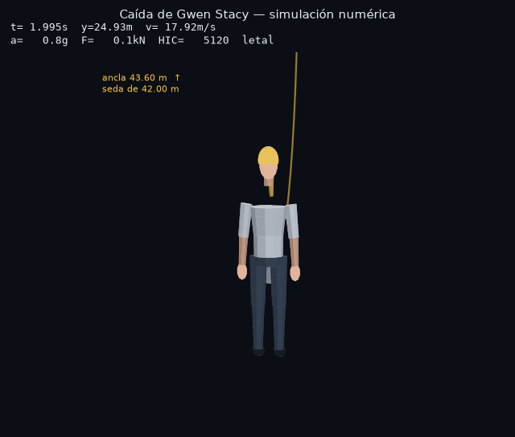
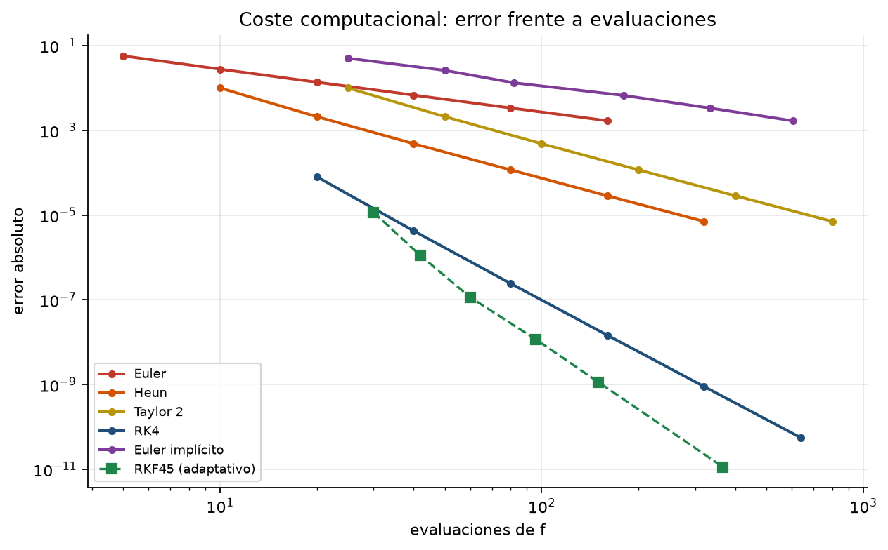
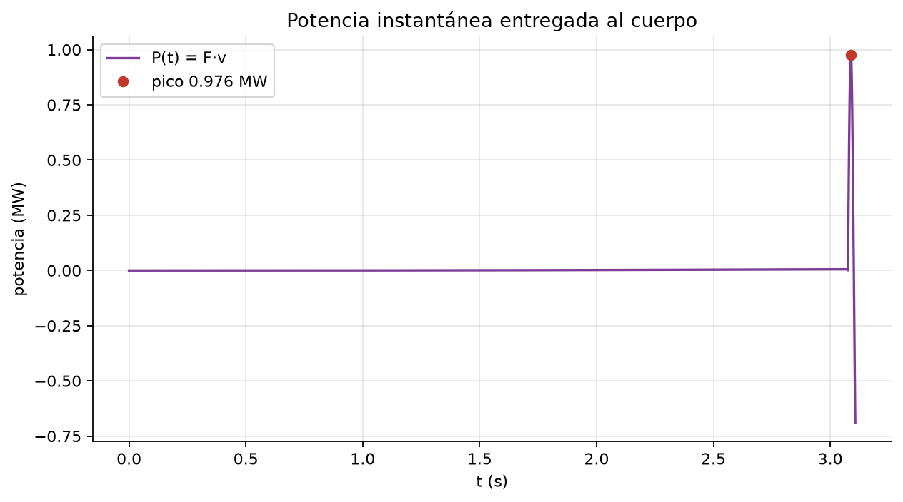
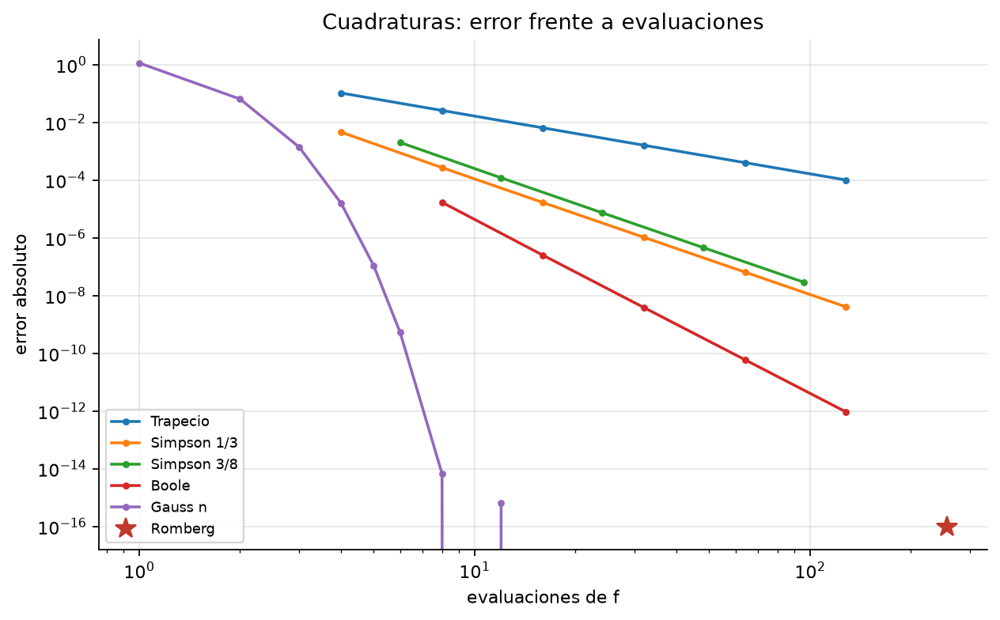
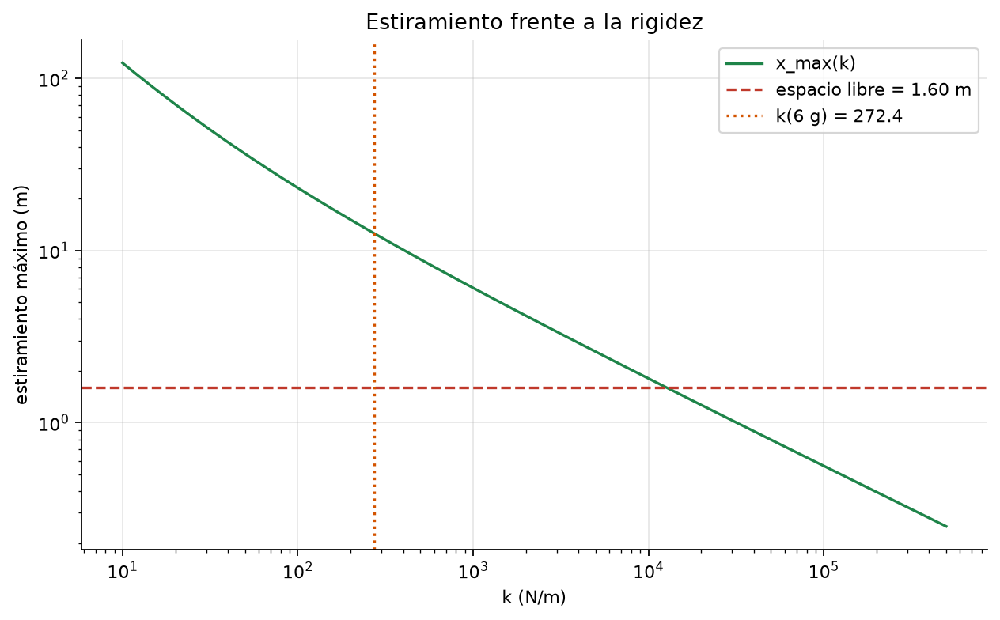
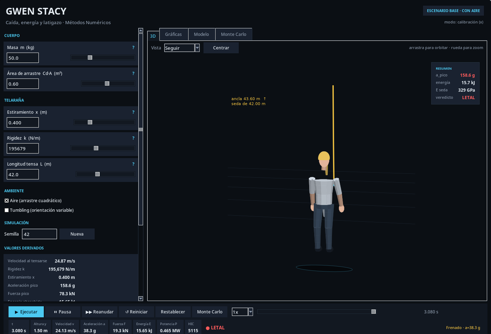
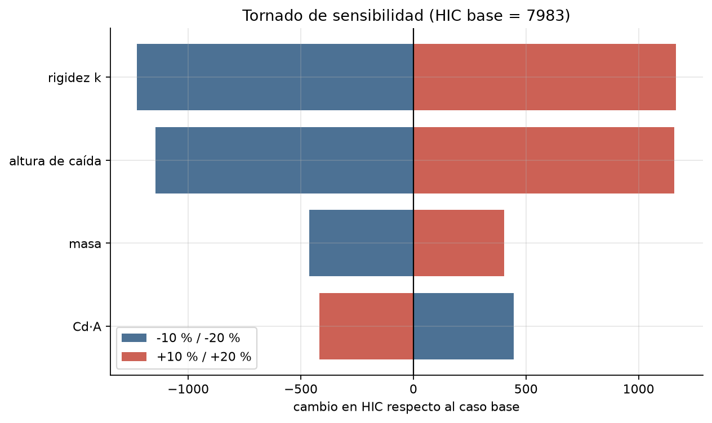
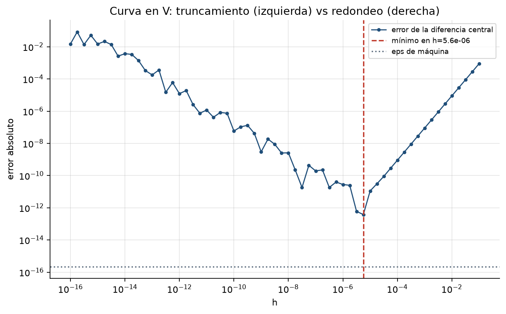

# La caída de Gwen Stacy: energía, potencia y latigazo

**Curso:** Métodos Numéricos
**Autor:** Diego
**Entregables:** informe técnico (este README), código documentado, app de escritorio con simulación 3D en tiempo real y diapositivas.

---

## 1. Introducción y pregunta

¿Cuánta energía recibió el cuerpo de Gwen Stacy y por qué esa energía no pudo
liberarse de forma gradual?

La respuesta corta es que **la energía no es el problema: lo es la tasa a la que
se entrega**. En el escenario de la película el cuerpo llega al tensado con
unos **15.7 kJ** de energía cinética (20.8 kJ si se ignora el aire) y debe
disiparlos en una fracción de segundo. La potencia pico real es del orden de
**1 MW** y la aceleración pico de **158.6 g** con arrastre, o **211 g** sin aire.

El proyecto reproduce la escena con tres modelos:

1. caída con arrastre cuadrático,
2. telaraña elástica lineal,
3. cuerpo articulado anclado en el torso.

El caso de validación es el análisis de la Universidad de Leicester (2021),
que con una caída de 42 m sin aire y 50 kg obtiene `v ≈ 28.7 m/s`, `x ≈ 16.7 m`,
`k ≈ 204.5 N/m` y `E ≈ 343 MPa` para un límite de 6 g. El mecanismo del
latigazo es el que Marvel confirmó en el correo de lectores de *ASM* #125.



---

## 2. Modelo matemático

### 2.1 Geometría

La escena se fija con cuatro datos coherentes:

| Magnitud | Valor | Origen |
|---|---:|---|
| Altura del ancla | 43.60 m | repisa inferior de la torre |
| Longitud tensa de la seda | 42.00 m | dato de la escena |
| Estiramiento observado | 0.40 m | dato de la escena |
| Altura final del torso | 1.20 m | `43.60 − 42.00 − 0.40` |
| Masa del cuerpo | 50 kg | Emma Stone ≈ 52 kg; Leicester usa 50 |
| `Cd·A` base | 0.60 m² | caída de espaldas/plana |
| Densidad del aire | 1.20 kg/m³ | aire a ~20 °C |

La verificación geométrica es exacta:

```
43.60 − 42.00 − 0.40 = 1.20 m
```

El ancla no está en la cúspide de los 72 m: Spider-Man se ancla en una repisa
inferior. El caso de la torre completa, con 70.4 m de caída, queda como
escenario paramétrico.

**Espacio libre.** En el instante de tensado el torso está a
`43.60 − 42.00 = 1.60 m` del suelo. Cualquier estiramiento mayor que 1.60 m
hace que el torso toque el suelo antes de detenerse. Este dato es central para
la conclusión.

### 2.2 Fase 1: caída con arrastre cuadrático

```
m dv/dt = m g − ½ ρ Cd A v²,     v(0)=0,  y(0)=0
```

Con `c = ½ ρ Cd A` y `v_t = sqrt(m g / c)`:

```
v(t) = v_t tanh(g t / v_t)
y(t) = (v_t²/g) ln cosh(g t / v_t)
```

El tiempo de caída se obtiene de `y(t_f) = H`:

```
t_f = (v_t/g) arccosh(exp(g H / v_t²))
```

Para el escenario base: `t_f = 3.076 s`, `v_t = 36.91 m/s`,
`v_0 = 24.87 m/s`.

### 2.3 Fase 2: telaraña elástica

```
m ẍ = m g − k x,     x(0)=0,  ẋ(0)=v_0
ω = sqrt(k/m)
x(t) = (g/ω²)(1 − cos ωt) + (v_0/ω) sin ωt
```

La aceleración máxima y el primer instante con `ẋ = 0` son:

```
a_max = sqrt(g² + (k/m) v_0²)
t_pico = (π − atan(v_0 ω / g)) / ω
```

La energía absorbida por la seda es:

```
E = ½ m v_0² + m g x_max
```

y la rigidez en modo calibración:

```
k = m(v_0² + 2 g x_max) / x_max²
```

En modo material se fija `k` y se despeja `x_max` de la misma ecuación
energética. Los dos modos se etiquetan explícitamente en todos los experimentos.

### 2.4 Potencia

La potencia instantánea es `P(t) = k x(t) ẋ(t)`. **No** es `F_max·v_0`: la
fuerza máxima ocurre cuando `ẋ = 0` y la velocidad máxima cuando `x = 0`.
Para el escenario base, `P_pico = 0.976 MW`; para el caso sin aire, `1.495 MW`.
La cota `F_max·v_0` (2.985 MW sin aire) se reporta solo como cota superior.

### 2.5 Fase 3: cuerpo articulado anclado en el torso

El cuerpo es atrapado en el torso. La cabeza (5 kg) y las piernas (20 kg) son
segmentos unidos por el cuello (0.18 m) y la cadera (0.45 m). La carga
cuasiestática en el pico es:

```
M_cuello = m_cabeza · r_cuello · (a_t + g)
M_cadera = m_piernas · r_cadera · (a_t + g)
```

Con `a_t = 158.6 g`: `M_cuello ≈ 1.41 kN·m` y `M_cadera ≈ 14.1 kN·m`.
Con `a_t = 6 g`: `M_cuello ≈ 61.8 N·m`, dentro del rango orientativo de
tolerancia cervical (30–90 N·m) pero en su límite alto.

El torso se detiene a 1.20 m y **no** se afirma que la cabeza o las piernas
golpeen el suelo: con el anclaje en el torso y esas longitudes, es
geométricamente imposible. El latigazo se mide por el momento cervical y la
aceleración relativa, no por un impacto contra el piso.

### 2.6 Criterio HIC

```
HIC = max (t₂ − t₁) · [ (1/(t₂−t₁)) ∫ a dt ]^2.5,   t₂ − t₁ ≤ 36 ms
```

La aceleración se expresa en g. El HIC es un criterio de **cabeza**; en este
proyecto se usa como índice comparativo de la carga del torso/cabeza y se
etiqueta como tal. Con un pulso constante de 158.6 g durante 25.2 ms el HIC es
`≈8·10³`; con la forma real del pulso (triangular) baja a `≈5·10³`. El
escenario de 6 g durante 0.86 s da `HIC ≈ 3.2` en la ventana de 36 ms (el valor
de ~70 que a veces se cita usa una ventana de 0.8 s, incompatible con la
definición).

---

## 3. Solución analítica y métodos numéricos

### 3.1 Caso base con aire

| Magnitud | Valor |
|---|---:|
| `v_0` | 24.866 m/s (89.5 km/h) |
| `k` | 195 679 N/m |
| `x_max` | 0.40 m |
| `a_max` | 158.58 g |
| `F_max` | 78.27 kN (160× el peso) |
| `E` absorbida | 15.654 kJ |
| `P_pico` real | 0.9757 MW |
| `t_pico` | 25.21 ms |
| `E` implícito de la seda | 328.74 GPa |
| `ε` | 0.95 % |
| `M_cuello` | 1.41 kN·m |

### 3.2 Validación de Leicester (sin aire)

| Magnitud | Proyecto | Paper |
|---|---:|---:|
| `v_0` | 28.706 m/s | 28.7 |
| `x` | 16.80 m | 16.7 |
| `k` | 204.375 N/m | 204.5 |
| `E` | 343.35 MPa | ~343 |
| `ε` | 40.0 % | — |

La diferencia de `x` (16.80 vs 16.7) es redondeo: con 6 g exactos y balance
energético, `x = 0.4 H = 16.8 m`.

### 3.3 Escenario de supervivencia (6 g con aire)

| Magnitud | Valor |
|---|---:|
| `k` | 272.37 N/m |
| `x_max` | 12.61 m |
| `ε` | 30.0 % |
| `E` implícito | 457.4 MPa |
| `E` absorbida | 21.65 kJ |
| `F_max` | 3.43 kN |
| `M_cuello` | 61.8 N·m |
| HIC (36 ms) | 3.2 |

Este escenario **no es viable**: necesita 12.61 m de estiramiento cuando solo
hay 1.60 m hasta el suelo, y su deformación del 30 % está en el límite de rotura
de la seda dragline.

### 3.4 Métodos numéricos implementados

| Unidad | Métodos | Archivo |
|---|---|---|
| Raíces | bisección, falsa posición, punto fijo, Newton-Raphson, secante | `simulador/raices.py` |
| EDO | Euler, Heun, Taylor 2, RK4, Euler implícito, RKF45 | `simulador/edo.py` |
| Lineales | LU con pivoteo, Thomas, Jacobi, Gauss-Seidel | `simulador/lineales.py` |
| Integración | trapecio, Simpson 1/3 y 3/8, Boole, Gauss-Legendre, Romberg | `simulador/integracion.py` |
| Interpolación | Lagrange, Newton, spline cúbico, mínimos cuadrados | `simulador/interpolacion.py` |
| Errores | error absoluto/relativo, orden observado, Richardson | `simulador/errores.py` |

La app y los experimentos usan **formas cerradas** para la física y los
integradores numéricos para validar, comparar y demostrar convergencia. El
bucle de dibujo nunca integra: solo interpola una trayectoria precalculada.

---

## 4. Resultados

### 4.1 Raíces (e10)


Los cinco métodos coinciden en la raíz de `x³ − 2x − 5`; bisección tarda 42
iteraciones, Newton converge en menos de 10. La misma infraestructura localiza
el instante de tensado (`t = 3.07567445 s`) y la rigidez crítica de 6 g
(`k = 204.375 N/m`). La tabla completa está en `resultados/e10_raices.csv`.

### 4.2 Convergencia (e1)


Los órdenes observados coinciden con los teóricos: Euler 1, Heun 2, Taylor 2,
RK4 4. La tabla completa está en `resultados/e1_tabla.csv`.



RK4 con paso grande supera a Euler con paso pequeño para el mismo número de
evaluaciones. RKF45 adaptativo es más barato que RK4 de paso fijo para la misma
tolerancia.

### 4.3 Rigidez (e2)

El benchmark `b0` midió 33.6 fps a 800×600 con ~200 polígonos y 7 segmentos;
como supera el umbral de 25 fps, la app usa `mplot3d` y no necesita el fallback
OpenGL.


El umbral teórico es `h_crit = 2/ω = 27.74 ms`. Euler explícito diverge para
`h > h_crit`; Euler implícito permanece estable para todos los pasos probados.

### 4.4 Energía, potencia y HIC (e3)


La energía cinética se transfiere a la seda en la fase elástica. La suma de
energías se conserva (con `β=0`) y el residuo numérico es del orden de `1e-8 J`.



La potencia pico real es `0.976 MW`, no `F_max·v_0`.


Con la ventana de 36 ms, un pulso de 158.6 g supera ampliamente el umbral 700.



Gauss-Legendre y Romberg alcanzan alta precisión con menos evaluaciones;
Simpson 1/3 es exacto para polinomios cúbicos.

### 4.5 Umbral de supervivencia (e4)





La región factible es **vacía**:

- para `a ≤ 6 g` se necesita `k = 272.4 N/m` y `x = 12.61 m`;
- para no tocar el suelo se necesita `x ≤ 1.60 m`, es decir `k ≥ 12 694 N/m`
  y `E ≥ 21.3 GPa` (más rígida que cualquier seda real);
- la seda real (1–10 GPa) se estira entre 3.8 y 12.6 m y el torso impacta el
  suelo a 18.6–24.9 m/s.

No existe una rigidez que cumpla ambas restricciones.

### 4.6 Latigazo (e5)


El torso se detiene a 1.20 m. La cabeza y la cadera permanecen por encima del
suelo; el daño proviene de la desaceleración y del momento cervical, no de un
golpe contra el piso.

### 4.7 Orientación (e6)


| Orientación | `Cd·A` | `v_0` | `a_max` | HIC (pulso constante) |
|---|---:|---:|---:|---:|
| De cabeza | 0.10 | 28.00 | 200.8 g | 12 793 |
| De pie | 0.25 | 26.99 | 186.6 g | 11 056 |
| De lado | 0.40 | 26.04 | 173.8 g | 9 591 |
| Plana | 0.60 | 24.87 | 158.6 g | 7 983 |
| Espalda extendida | 0.70 | 24.31 | 151.7 g | 7 301 |
| Sin aire | — | 28.71 | 211.0 g | 14 131 |

La velocidad varía un 18 % entre los extremos, pero el HIC se amplifica ~1.9×.
El factor 1.5 del plan original solo aplica al modo de `k` fijo sobre el rango
completo; aquí se reporta el modo calibración (`x=0.4`).

### 4.8 Monte Carlo (e7)


Con `n = 2000` y semilla 42: `a_max` mediana 158.8 g, HIC mediano 7 989,
`x` mediano 0.40 m y **100 %** de las ejecuciones con HIC > 700. El percentil 5
de `a_max` sigue muy por encima de 6 g.

### 4.9 Interfaz 3D



La app de escritorio usa un tema oscuro pizarra + cian, un maniquí low-poly
articulado (cabeza, cuello, torso, brazos, manos, piernas y pies), una seda
dorada que se une a la cintura y tres encuadres: **Seguir**, **Cuerpo** y
**Torre**. Cada variable tiene símbolo, unidad y un tooltip; el panel muestra
los valores derivados y el veredicto (letal/supervivencia). El benchmark `b1`
dio 37 fps a 800×600 con el maniquí completo, por lo que no fue necesario el
fallback OpenGL.

### 4.10 Sensibilidad (e8)



La rigidez y la altura de caída dominan el HIC; la masa y el `Cd·A` tienen un
efecto menor. El resultado cualitativo no depende de los parámetros: el
escenario es letal en todo el rango razonable.

---

## 5. Análisis de error

### 5.1 Truncamiento y redondeo

El error de truncamiento disminuye con `h` según el orden del método; el error
de redondeo crece al disminuir demasiado `h` (la clásica curva en V). Se
implementaron diferencias adelante, atrás y central; la central es `O(h²)` y
la adelante/atrás `O(h)`.



En la práctica el mínimo de la diferencia central aparece alrededor de
`h = 5.6·10⁻⁶`, con un error de `3.8·10⁻¹³`; por debajo de ese paso domina el
redondeo de doble precisión.

### 5.2 Orden observado

La tabla `resultados/e1_tabla.csv` incluye `h`, error, orden observado y número
de evaluaciones. Los órdenes medidos son:

| Método | Orden teórico | Orden observado |
|---|---:|---:|
| Euler | 1 | ≈1.00 |
| Heun | 2 | ≈2.00 |
| Taylor 2 | 2 | ≈2.00 |
| RK4 | 4 | ≈4.00 |
| Euler implícito | 1 | ≈1.00 |

### 5.3 Propagación Monte Carlo

El error estándar de la media decae como `σ/√n`. Con `n = 100, 400, 1600` la
razón entre errores sucesivos es ≈2, como corresponde.

### 5.4 Limitaciones

- El modelo es 1D en la fase de caída y cuasiestático en el articulado.
- La seda se modela como resorte lineal; la seda real es viscoelástica y tiene
  una deformación de rotura finita.
- El HIC se usa como índice comparativo, no como diagnóstico clínico.
- La geometría de 43.60 m es una reconstrucción de la escena, no un dato
  topográfico oficial.

---

## 6. Conclusiones

1. **La energía no mata por sí sola.** El cuerpo recibe 15.7 kJ con aire
   (20.8 kJ sin aire) y debe disiparlos en ~25 ms. La potencia pico real es
   ~1 MW.
2. **La geometría no da margen.** Con 1.60 m hasta el suelo, cualquier seda
   que evite el impacto debe ser más rígida que la seda real y aun así impone
   ≥40 g. Cualquier seda real se estira más de 1.6 m y el torso impacta.
3. **El escenario de 6 g es físicamente inviable.** Necesita 12.6 m de
   estiramiento y 30 % de deformación; no cabe en la escena.
4. **El latigazo es el mecanismo final.** Con el anclaje en el torso, el
   momento cervical alcanza ~1.4 kN·m, muy por encima del rango de tolerancia.
   La cabeza y las piernas no necesitan golpear el suelo para explicar el daño.
5. **El modelo numérico es consistente.** Leicester se reproduce, los órdenes
   de convergencia coinciden con la teoría, el sistema rígido exige métodos
   implícitos y Monte Carlo confirma que el resultado es robusto.

---

## 7. Ejecución y estructura

```bash
# entorno
python3 -m venv .venv
.venv/bin/pip install -r requirements.txt

# suite completa
.venv/bin/python -m pytest -q

# regenerar figuras y tablas
.venv/bin/python -m experimentos.e1_convergencia
.venv/bin/python -m experimentos.e2_rigidez
.venv/bin/python -m experimentos.e3_energia_hic
.venv/bin/python -m experimentos.e4_umbral
.venv/bin/python -m experimentos.e5_latigazo
.venv/bin/python -m experimentos.e6_rozamiento
.venv/bin/python -m experimentos.e7_montecarlo
.venv/bin/python -m experimentos.e8_sensibilidad
.venv/bin/python -m experimentos.e9_redondeo
.venv/bin/python -m experimentos.e10_raices
.venv/bin/python -m experimentos.b1_benchmark_humanoide

# escenarios
.venv/bin/python run.py --escenario base
.venv/bin/python run.py --escenario leicester
.venv/bin/python run.py --escenario supervivencia

# app 3D y MP4
.venv/bin/python -m visual.app_tkinter
.venv/bin/python -m visual.render_mp4 --semilla 42 --salida resultados/pelicula.mp4
```

```
Proyectofinal/
├── AGENTS.md                 reglas del proyecto para agentes
├── README.md                 este informe
├── run.py                    CLI de escenarios y experimentos
├── requirements.txt
├── pyproject.toml
├── simulador/                física y métodos numéricos
├── experimentos/             e1-e8 y benchmark b0
├── visual/                   escena 3D, reproductor, MP4 y app Tk
├── tests/                    suite completa + valores golden
├── datos/referencia.csv      valores congelados
├── resultados/               figuras y tablas
└── docs/                     presentación
```

### Reproducibilidad

- Semilla fija en Monte Carlo (`numpy.random.Generator`).
- Sin estado global; cada ejecución crea su propio generador.
- `datos/referencia.csv` se verifica en cada corrida de la suite.
- Las figuras del informe se versionan; el MP4 se regenera con el comando de
  arriba.

---

## 8. Referencias

- Universidad de Leicester, *The physics of Gwen Stacy's fall* (2021).
- Marvel, *The Amazing Spider-Man* #125, correo de lectores (latigazo).
- Burden & Faires, *Análisis numérico* (métodos de raíces, EDO e integración).
- Chapra & Canale, *Métodos numéricos para ingenieros*.
- Datos antropométricos aproximados para los segmentos corporales.
